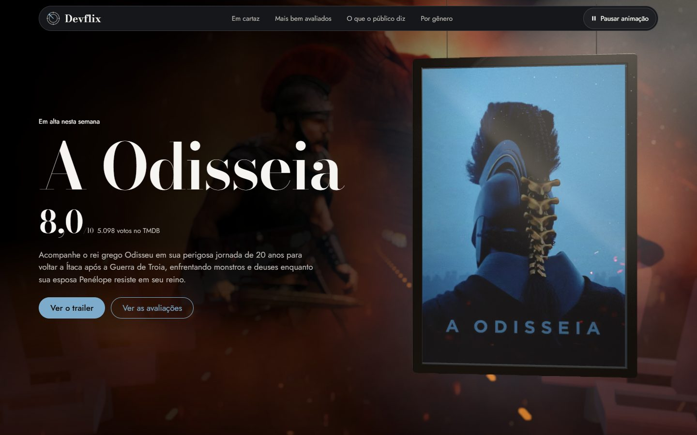
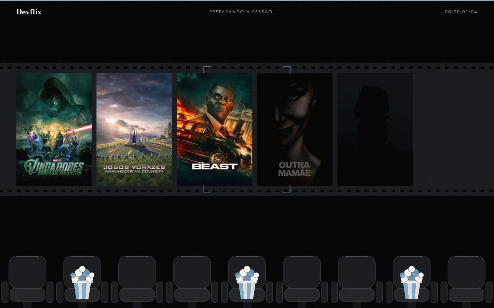
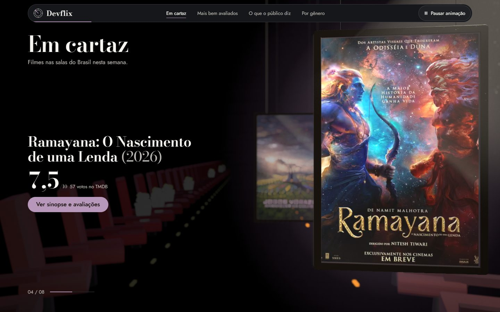
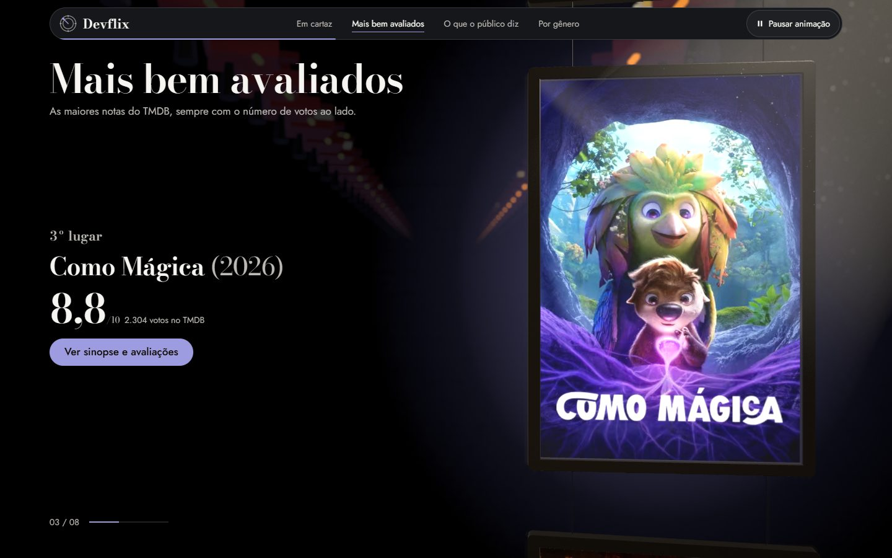
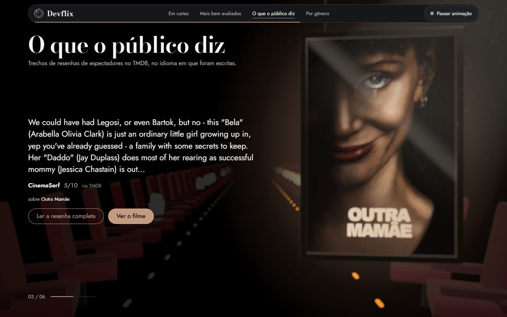
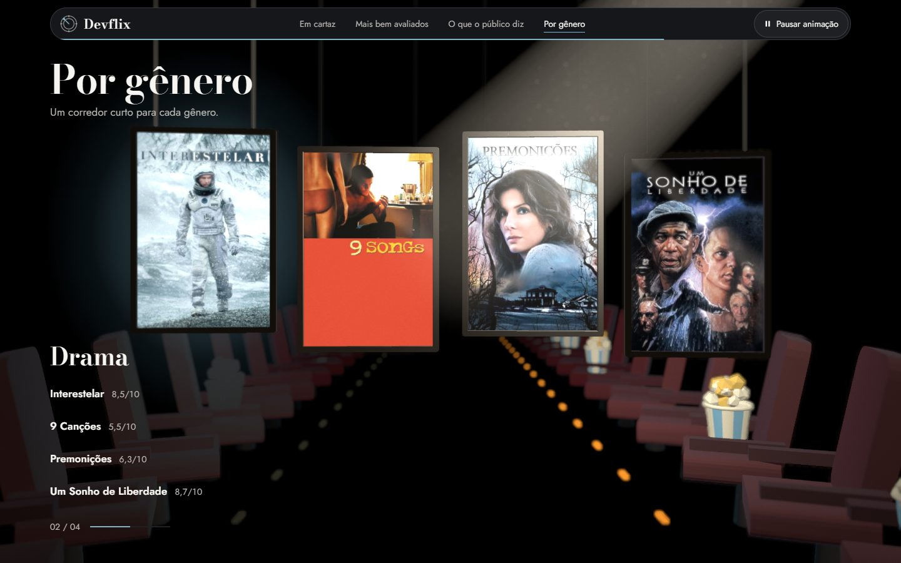
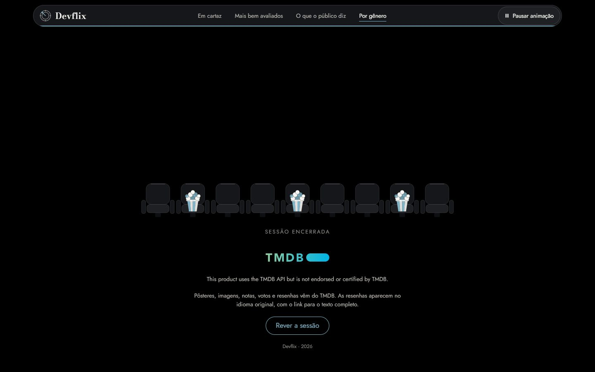
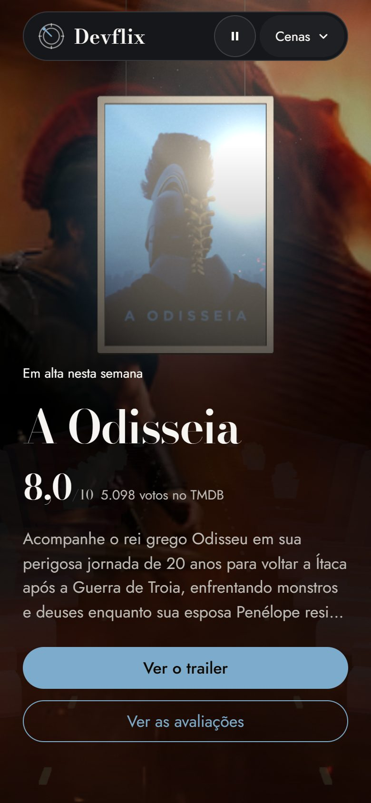
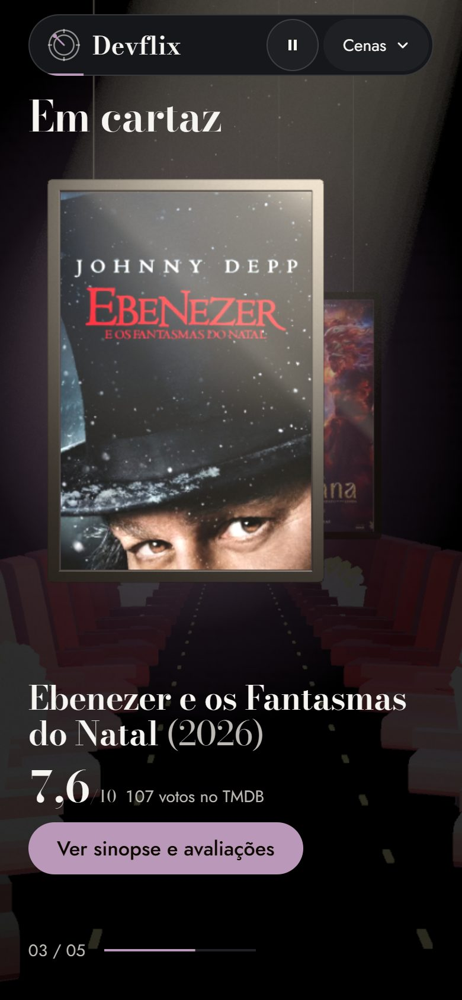
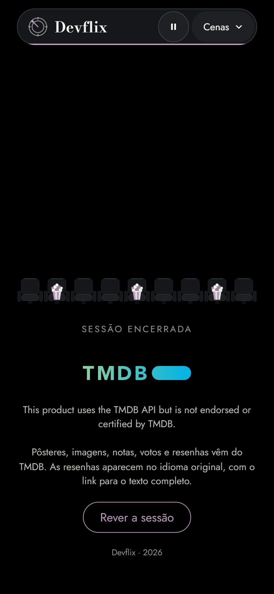

<div align="center">

# Devflix

**A rolagem é a linha do tempo de um filme.**
Um catálogo com dados do [TMDB](https://www.themoviedb.org/), contado por uma cena 3D numa sala de projeção.




</div>

## A ideia

Uma sala de cinema escura, com plateia, feixe de projetor e pôsteres pendurados como caixas de luz. Ao
rolar a página, a câmera atravessa a sala e para em cada filme. O 3D conta a história. Toda a informação
fica no HTML.

### As 3 leis do projeto

1. **O 3D conta a história, o HTML carrega a informação.** Todo texto, nota, avaliação e link existe no
   DOM, indexável e legível por leitor de tela. O canvas nunca é a única fonte de nada.
2. **Nada de dado inventado.** Nota, autor, citação e número de votos vêm do TMDB. Filme sem resenha
   mostra só a nota e os votos.
3. **A chave do TMDB fica no servidor.** `TMDB_TOKEN`, nunca com prefixo `NEXT_PUBLIC_`, nunca numa
   requisição do navegador.

## Um passeio pela sessão

<table>
  <tr>
    <td width="50%"></td>
    <td width="50%"></td>
  </tr>
  <tr>
    <td><b>Carregamento.</b> Uma película de 35 mm. Cada marco real de carga (fontes, cena, pôster, fundo) avança um quadro.</td>
    <td><b>Em cartaz.</b> A câmera percorre o corredor da sala e para em cada pôster. A cor de destaque vem do próprio pôster.</td>
  </tr>
  <tr>
    <td></td>
    <td></td>
  </tr>
  <tr>
    <td><b>Mais bem avaliados.</b> A tira de pôsteres desce do 1º ao último lugar, sempre com a nota e os votos.</td>
    <td><b>O que o público diz.</b> Resenhas reais do TMDB, no idioma original, com autor, nota e o link para o texto completo.</td>
  </tr>
  <tr>
    <td></td>
    <td></td>
  </tr>
  <tr>
    <td><b>Por gênero.</b> Uma parada da câmera para cada gênero, com poucos filmes à vista.</td>
    <td><b>Créditos.</b> "Fim", os créditos sobem com a rolagem e a sessão fecha com a atribuição do TMDB.</td>
  </tr>
</table>

### No celular

<table>
  <tr>
    <td width="33%"></td>
    <td width="33%"></td>
    <td width="33%"></td>
  </tr>
</table>

O layout é pensado para 390 px: alvos de toque de pelo menos 44 px, menu em disclosure e a mesma cena em
uma versão mais leve.

## O que a página tem

- **Cena 3D** com React Three Fiber. A plateia (cadeiras, baldes de pipoca e luzes de corredor) é
  instanciada e custa 3 draw calls. Feixe de projetor com poeira, pôsteres como caixas de luz,
  profundidade de campo, grão de filme e vinheta.
- **Luz que não atrapalha a leitura.** A plateia escurece onde passa o texto em HTML, para o contraste
  não depender de onde a pipoca ficou.
- **Letras que entram uma a uma** nos títulos, mantendo o nome acessível inteiro para leitor de tela.
- **Cabeçalho flutuante** que marca a cena atual e mostra o progresso da rolagem.
- **Qualidade adaptável.** Um governador mede os quadros por segundo e sobe ou desce o nível de
  qualidade, com histerese (`src/scene/quality.ts`, com testes).
- **Acessibilidade e fallback.** Com `prefers-reduced-motion`, sem WebGL ou sem JavaScript, a página usa
  seções 2D completas, sem câmera e sem canvas.

## Tecnologia

| Camada | Escolha |
|---|---|
| Framework | Next.js 15 (App Router), React 19, TypeScript estrito |
| 3D | three.js, React Three Fiber, drei, postprocessing, shaders GLSL próprios |
| Movimento | GSAP com ScrollTrigger e Lenis (um único controle de rolagem) |
| Estilo | Tailwind CSS 4, tokens de cor em OKLCH |
| Fontes | Bodoni Moda (títulos) e Jost (texto), via `next/font` |
| Dados | API do TMDB, lida só no servidor |

## Como rodar

Requisitos: Node.js 20 ou mais novo e um token de leitura da API do TMDB.

```bash
git clone https://github.com/FelipePrado200/devflix2.0.git
cd devflix2.0
npm install
cp .env.example .env.local   # no Windows: copy .env.example .env.local
```

Abra o `.env.local` e preencha o token (o "API Read Access Token" v4, em
<https://www.themoviedb.org/settings/api>):

```
TMDB_TOKEN=seu_token_aqui
```

Depois:

```bash
npm run dev      # desenvolvimento em http://localhost:3000
npm run build    # build de produção
npm run start    # servidor de produção
npm test         # testes do governador de qualidade
npm run lint
```

Sem o token, a página mostra um aviso em vez de quebrar.

### Parâmetros úteis na URL

| Parâmetro | Efeito |
|---|---|
| `?nopreroll` | Pula a tela de carregamento (útil em testes). |
| `?debug=1` | Expõe `window.__stage` e `window.__three`, ganchos usados nos testes de navegador. |

## Estrutura

```
src/
  app/          página, layout, estilos globais e a rota /api/movie
  components/   HTML da página: cabeçalho, cartões, painel do filme, créditos, carregamento
    stage/      a ponte entre a rolagem e a câmera 3D
  scene/        sala, feixe, efeitos, qualidade adaptável e shaders GLSL
  lib/          cliente do TMDB, cor, formatação, rolagem
  motion/       tokens.ts: toda duração, curva e amortecimento
docs/
  storyboard.md   cena, intervalo de rolagem e intenção de câmera
  efeitos.md      cada efeito, a técnica e o custo medido
DESIGN.md         cor, tipografia, componentes e o que é proibido
```

Nenhum número de tempo, curva ou cor fica solto no código: tudo vem de `src/motion/tokens.ts` e do
`DESIGN.md`.

## Desempenho

O projeto tem um orçamento de desempenho como contrato.

| Medida | Limite | Situação |
|---|---|---|
| JavaScript inicial, comprimido, antes do 3D | 180 KB | 178 KB (pouca folga) |
| Draw calls por quadro | 120 | 33 |
| Chunk da cena 3D, comprimido | 450 KB | ainda não medido de novo |
| LCP no celular, CLS, INP | 2,5 s, 0,05, 200 ms | medidos em fases anteriores, a repetir após os créditos |

O custo de cada efeito, medido num notebook com RTX 3050, está em [docs/efeitos.md](docs/efeitos.md).

## Limitações conhecidas

- O recuo final da câmera 3D (cena 6 do storyboard) ainda não existe. Hoje o final é feito em HTML
  sobre fundo preto.
- No celular, o título de "O que o público diz" pode encostar no pôster.
- O JavaScript inicial está perto do limite de 180 KB.

## Créditos

Dados, pôsteres, notas e resenhas vêm do [TMDB](https://www.themoviedb.org/). Os pôsteres pertencem aos
seus respectivos detentores de direitos.

> This product uses the TMDB API but is not endorsed or certified by TMDB.
